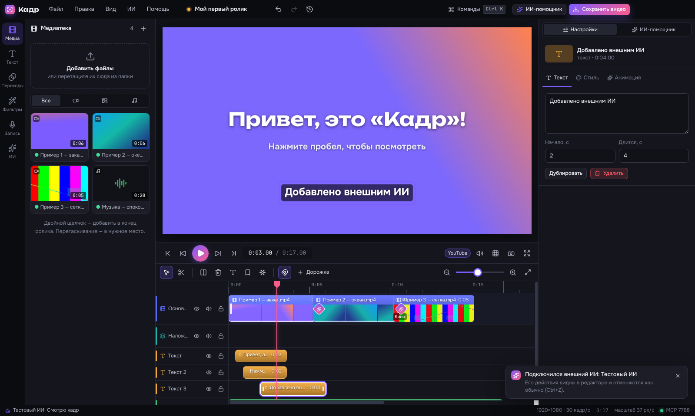

<p align="center"></p>

<h1 align="center">Кадр</h1>

<p align="center"><b>Простой и красивый видеоредактор для Windows с ИИ-помощником.</b><br>
Каждое действие сразу видно, любое можно отменить, а нейросеть монтирует по вашей просьбе.</p>

<p align="center"></p>

## Установка

1. Откройте страницу [Releases](https://github.com/krasking94/kadr-editor/releases) (или вкладку **Actions** → последняя сборка → **Kadr-Windows**).
2. Скачайте `Kadr-Setup-….exe` и запустите. Есть и версия без установки: `Kadr-…-win-x64.zip`.
3. Windows может показать «Система Windows защитила ваш компьютер» — у программы пока нет платной цифровой подписи. Нажмите **Подробнее → Выполнить в любом случае**.

FFmpeg (движок обработки видео) уже внутри, ничего дополнительно ставить не нужно.

## Что умеет

**Монтаж**
- Магнитная основная дорожка: клипы встают встык, их легко переставлять.
- Наложения (картинка в картинке), несколько дорожек текста и звука.
- Подрезка краёв мышью, ножницы, разрезание по линии времени (`S`), прилипание к краям и меткам.
- 19 переходов с живым предпросмотром, плавное появление и исчезновение.
- Скорость от ×0.1 до ×8, стоп-кадр, отделение звука, дублирование, копирование и вставка.
- Метки на линейке, сохранение кадра картинкой.

**Картинка и текст**
- 10 цветовых стилей (кино, винтаж, ч/б, тёплый…), яркость, контраст, насыщенность, гамма, температура.
- Виньетка, зерно плёнки, размытие, резкость, отражение.
- Движение: плавное приближение, панорама, поворот — «оживление» фотографий.
- 12 готовых стилей текста, 12 шрифтов с кириллицей, обводка, тень, плашка, 7 анимаций появления.
- Текст и картинку можно двигать мышью прямо в окне просмотра.

**Звук**
- Волна звука на клипах, громкость до 200 %, плавное начало и конец.
- Музыка автоматически становится тише, когда говорят.
- Запись голоса с микрофона под картинку и видео с веб-камеры.

**Умные инструменты**
- Убрать паузы в речи (работает без интернета).
- Разрезать видео по сменам сцен.
- Субтитры из речи (OpenAI Whisper, Groq и другие).

**Сохранение**
- MP4, MOV, WebM, GIF, MP3, WAV. Размер от 360p до 4K, 24–60 кадров в секунду.
- Ускорение видеокартой NVIDIA, Intel и AMD — находится автоматически.
- Готовые варианты: YouTube, Telegram/ВК, быстрый черновик, GIF для чата.

**Удобство**
- Отмена и история шагов: видно, кто что сделал — вы или ИИ.
- Палитра команд `Ctrl+K`: найти любое действие по названию.
- Горячие клавиши работают в русской и английской раскладке.
- Автосохранение и восстановление после сбоя. Тёмная и светлая тема.

## ИИ-помощник

Откройте **Настройки → Нейросети**, выберите сервис и вставьте ключ. Готовы к работе:

| Сервис | Нужен ключ | Видит кадры |
|---|---|---|
| Claude (Anthropic) | да | да |
| ChatGPT (OpenAI) | да | да |
| Gemini (Google) | да | да |
| DeepSeek, Mistral, Qwen, YandexGPT | да | нет |
| Grok (xAI), OpenRouter | да | да |
| Groq | да | нет |
| Ollama, LM Studio — на вашем компьютере | нет | нет |
| Любой OpenAI-совместимый адрес | по ситуации | по ситуации |

Пишите обычными словами: «убери паузы и добавь субтитры», «сделай вертикальную версию для Reels», «поставь переходы и музыку потише». Помощник пользуется теми же действиями, что и вы: изменения видны на таймлайне, подсвечиваются и отменяются `Ctrl+Z`.

Ключи хранятся на компьютере в зашифрованном виде (средствами Windows) и отправляются только выбранному сервису.

## Подключение внешнего ИИ по MCP

«Кадр» сам является MCP-сервером: Claude Code, Claude Desktop, Cursor и другие программы могут монтировать в нём, а вы видите каждое их действие. Сервер слушает только этот компьютер: `http://127.0.0.1:7788/mcp`.

**Claude Code:**
```
claude mcp add --transport http kadr http://127.0.0.1:7788/mcp
```

**Claude Desktop** (работает по обычной подписке, нужен [Node.js](https://nodejs.org)):

1. В Claude Desktop: ☰ → Файл → Настройки → **Разработчик** → **Изменить конфигурацию**. Откроется `%APPDATA%\Claude\claude_desktop_config.json`.
2. Вставьте и сохраните:
```json
{ "mcpServers": { "kadr": { "command": "cmd", "args": ["/c", "npx", "-y", "mcp-remote", "http://127.0.0.1:7788/mcp"] } } }
```
3. Полностью выйдите из Claude (значок у часов → Выход) и откройте снова. Держите «Кадр» открытым.

**Cursor, VS Code и другие:**
```json
{ "mcpServers": { "kadr": { "url": "http://127.0.0.1:7788/mcp" } } }
```

Доступно 23 инструмента: посмотреть проект и кадр, добавить файлы, резать, двигать, менять цвет и эффекты, переходы, текст, субтитры, распознавание речи, удаление пауз, поиск сцен, отмена и сохранение видео.

В обратную сторону тоже работает: в **Настройки → Внешний ИИ (MCP)** можно подключить к встроенному помощнику любые MCP-серверы, и их инструменты станут ему доступны.

## Для разработчиков

Нужны Node.js 22 и Git.

```bash
git clone https://github.com/krasking94/kadr-editor
cd kadr-editor
npm install
npm run ffmpeg      # скачать FFmpeg для Windows в resources/ffmpeg/win32
npm run dev         # запуск с мгновенным обновлением интерфейса
npm test            # тест экспорта через настоящий FFmpeg
npm run dist:win    # установщик в папке release/
```

Как устроено:

| Папка | Что внутри |
|---|---|
| `electron/` | Главный процесс: окно, файлы, FFmpeg, ИИ-сервисы, MCP-сервер и клиент |
| `shared/` | Общее: модель проекта, таймлайн, сборка команды FFmpeg для экспорта, список инструментов ИИ |
| `src/` | Интерфейс на React: состояние и действия редактора, панели, окна |
| `tests/` | Тесты, включая полный экспорт через FFmpeg |

Главная идея: все изменения проекта проходят через одну функцию `commit()` в `src/state/store.ts`. Поэтому у любого действия — от кнопки, горячей клавиши, ИИ-помощника или внешнего ИИ — есть отмена, запись в истории и подсветка на таймлайне.

Сборка для Windows идёт автоматически в GitHub Actions (`.github/workflows/build.yml`): проверки, тест экспорта, установщик и проверка запуска. Чтобы выпустить версию, поставьте метку `v0.1.0` — файлы появятся на странице релиза.

## Лицензия

MIT. FFmpeg поставляется отдельной программой со своей лицензией (GPL). Шрифты — SIL Open Font License.
